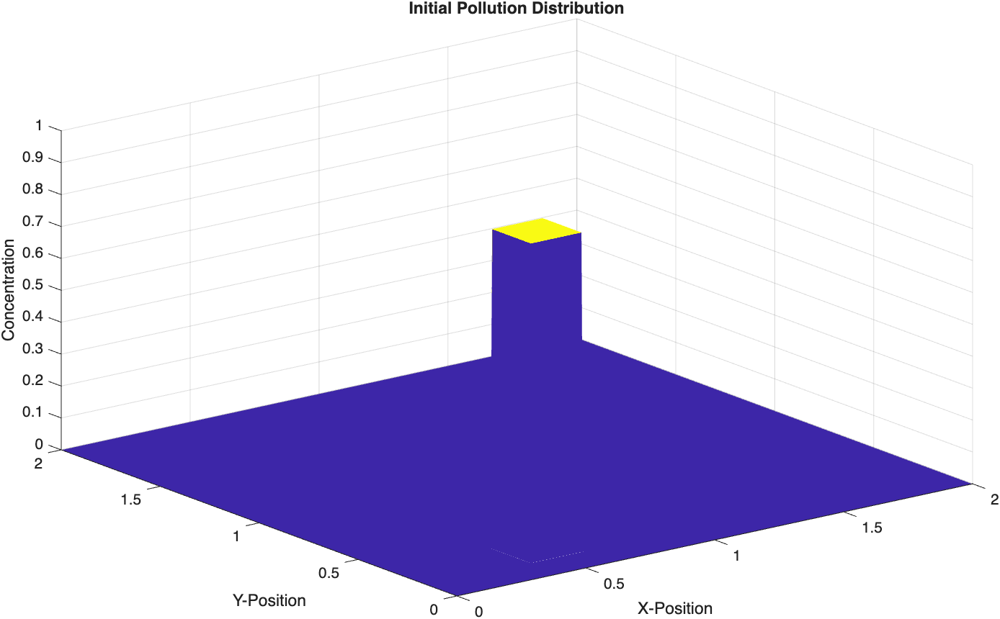
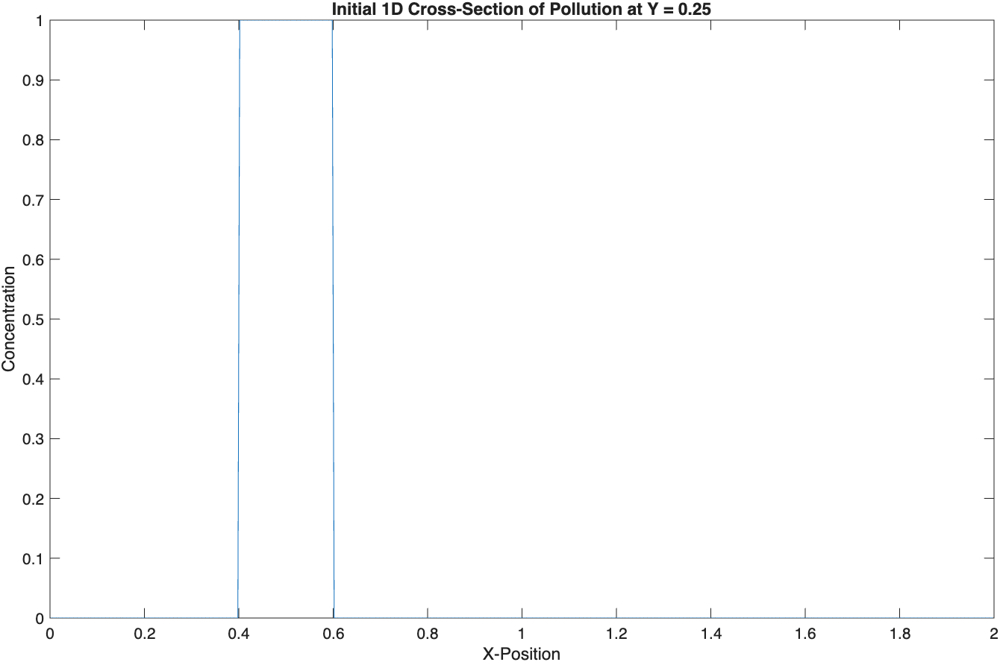
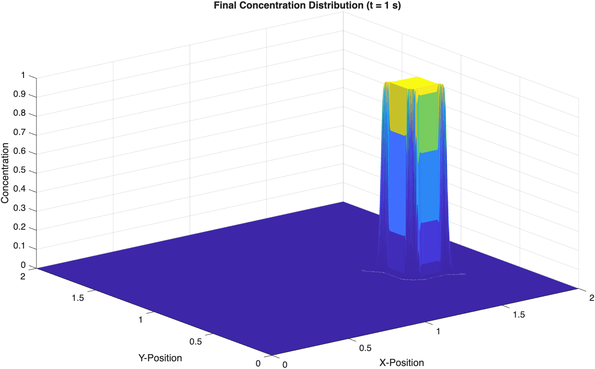
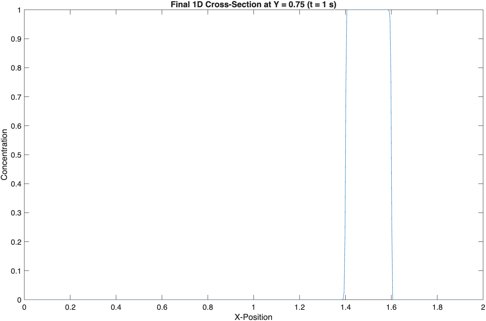

# 2D Advection-Diffusion Solver

-success)

A MATLAB-based Computational Fluid Dynamics (CFD) solver for the 2D transient advection-diffusion equation. 

This project utilizes a cell-centered Finite Volume Method (FVM) with Forward Euler time integration. To prevent non-physical oscillations (numerical dispersion) near steep gradients, it implements a Second-Order Upwind (SOU) scheme coupled with selectable flux limiters (MC Limiter and Minmod).

## Features
* 2D Advection and Diffusion transport modeling
* Cell-centered Finite Volume discretization
* Total Variation Diminishing (TVD) schemes via MC and Minmod limiters
* Dynamic mass conservation tracking

## Getting Started

### Prerequisites
* MATLAB (R2020a or newer recommended)

### Usage
1. Clone this repository or download the files.
2. Open `example_run.m` in MATLAB.
3. Adjust the physical parameters (velocity `vx`, `vy`, diffusion coefficient `alpha`) or grid size (`Nx`, `Ny`) as needed.
4. Select your preferred flux limiter on line 18 (`limiterType = 'MC';` or `'minmod'`).
5. Run the script. The script will automatically generate 3D surface plots and 1D cross-sectional slices of the initial and final concentration fields.

## Results

### Initial State
**3D Distribution**

**1D Cross-Section (Y = 0.25)**

---

### Final State (After 1000 Time Steps)
**3D Distribution**

**1D Cross-Section (Y = 0.75)**

## File Structure
* `solveAdvectionDiffusion2D.m` - The core numerical solver function and limiter definitions.
* `example_run.m` - The execution script containing grid setup, initial conditions, and visualization.

## Author
Chun Heng Pen, National Cheng Kung University
